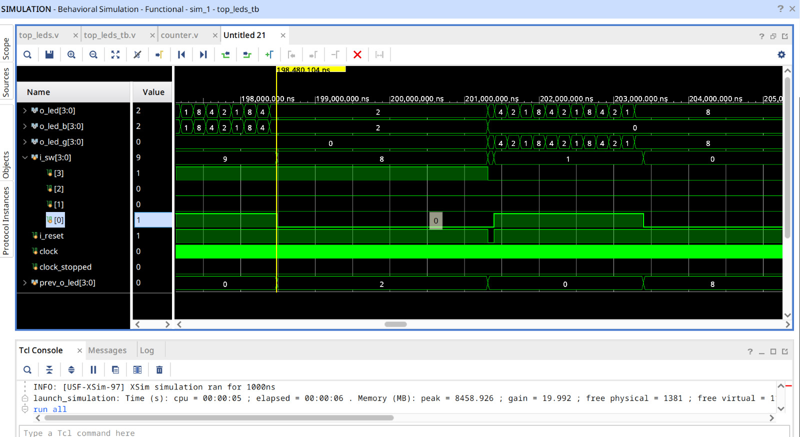
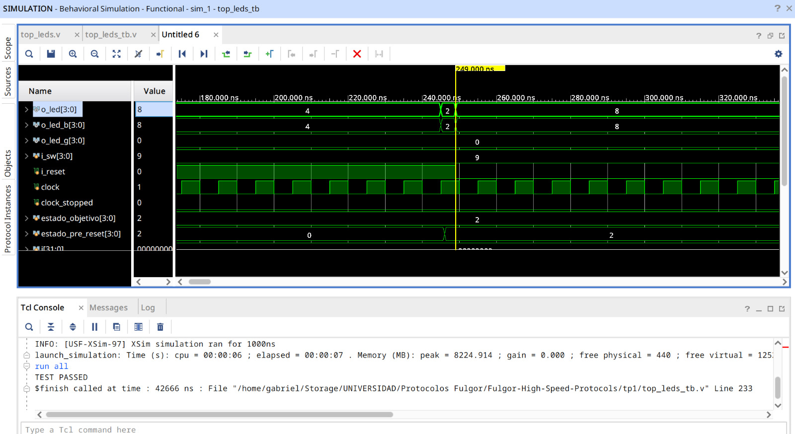
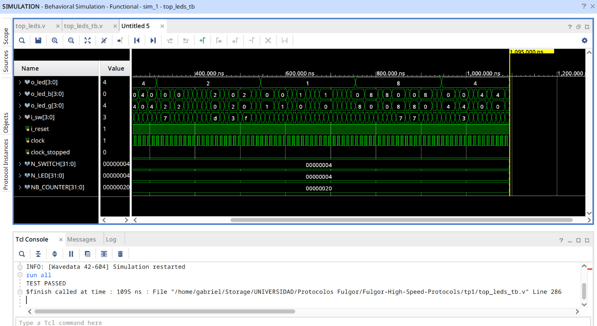
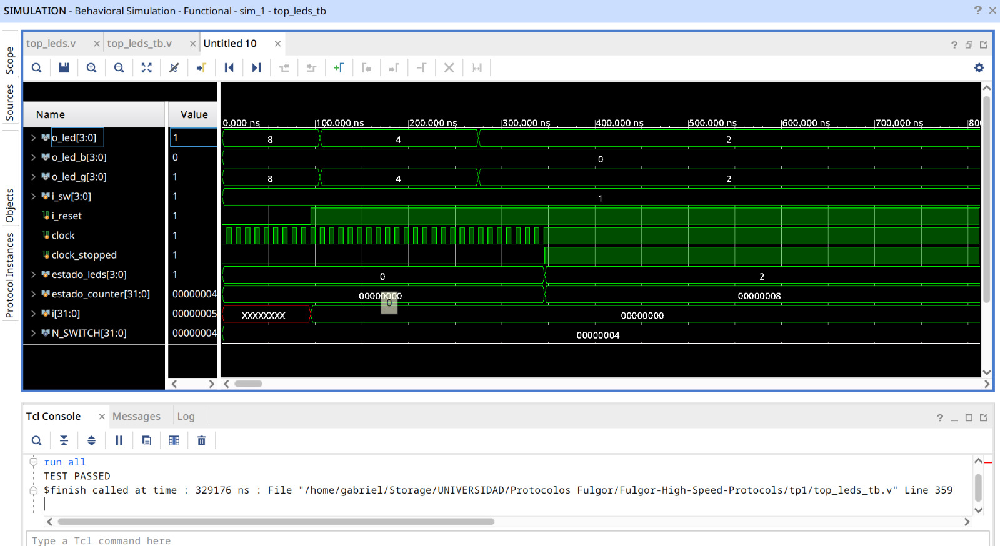
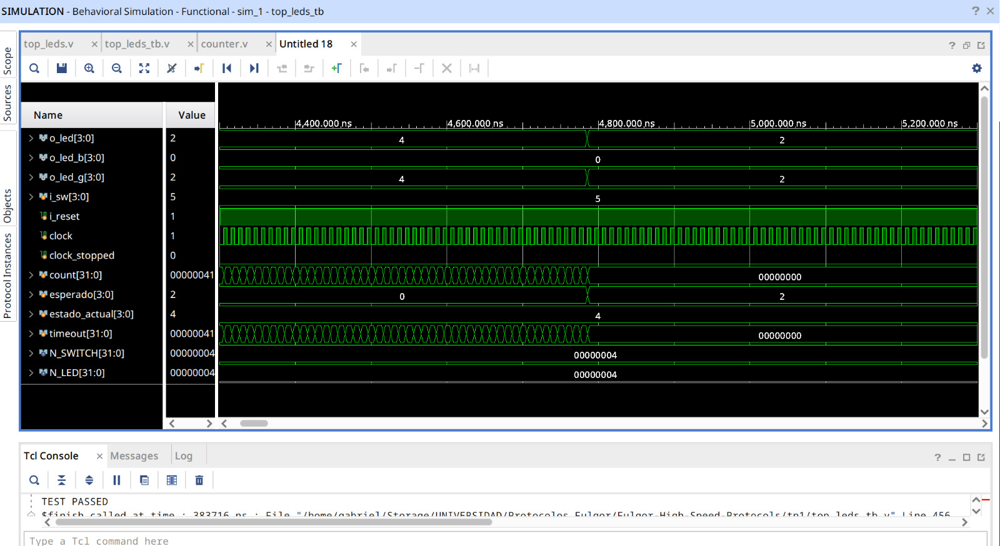
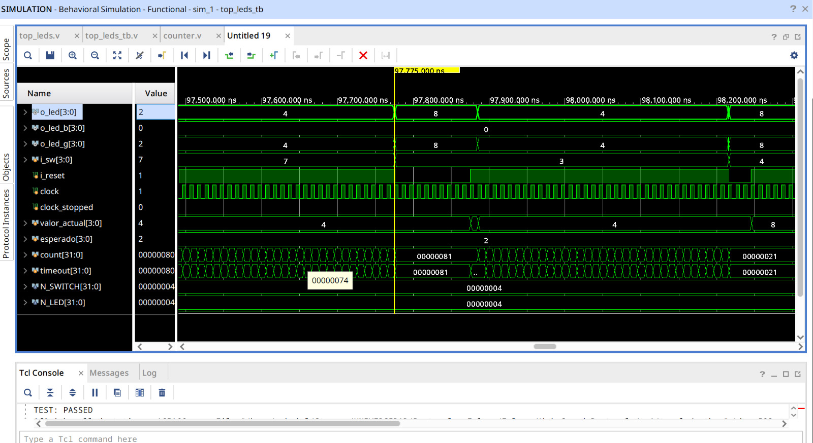

# TP1 - Verificación funcional del módulo `top_leds`

## Descripción general

En este trabajo se verificó funcionalmente el módulo `top_leds` mediante un testbench en Verilog/SystemVerilog.  
El diseño implementa una secuencia de desplazamiento sobre LEDs y permite controlar su comportamiento mediante switches de entrada.

Las señales principales del diseño son:

- `i_sw[0]`: enable del circuito.
- `i_sw[2:1]`: selector de límite del contador.
- `i_sw[3]`: selector de color.
- `i_reset`: reset activo en bajo.
- `clock`: señal de reloj.
- `o_led[3:0]`: salida principal de LEDs.
- `o_led_b[3:0]`: salida de LEDs azules.
- `o_led_g[3:0]`: salida de LEDs verdes.

Para acelerar las simulaciones se forzaron límites reducidos en el contador:

```verilog
force u_top_leds.u_counter.limit_0 = 32'h0000_0010;
force u_top_leds.u_counter.limit_1 = 32'h0000_0020;
force u_top_leds.u_counter.limit_2 = 32'h0000_0040;
force u_top_leds.u_counter.limit_3 = 32'h0000_0080;
```

Cada prueba fue ejecutada individualmente, habilitando un único `define` por vez dentro del testbench.

---

## TEST1 - Verificación de enable

### Objetivo

Verificar que, cuando `i_sw[0] = 0`, el estado de los LEDs permanece estable aunque el clock continúe activo.

### Descripción

En esta prueba se deja avanzar el circuito con `enable = 1`. Luego se desactiva el enable, se guarda el valor actual de `o_led` y se verifica durante un tiempo aleatorio que la salida no cambie.

En la Figura 1 se observa que, al desactivar `i_sw[0]`, el valor de `o_led` queda estable mientras el clock continúa oscilando.



### Resultado

`TEST PASSED`

---

## TEST2 - Verificación de reset

### Objetivo

Verificar que el reset lleve el circuito al estado inicial esperado.

### Descripción

El reset del diseño es activo en bajo. En esta prueba se verifica que, al aplicar `i_reset = 0`, la salida `o_led` vuelva al valor inicial `4'b1000`.

Además, el reset se aplica desde un estado distinto al inicial, para evitar confundir el efecto del reset con una transición normal de la secuencia.

En la Figura 2 se observa que el circuito se encontraba en un estado diferente y, al aplicar reset, `o_led` vuelve correctamente a `4'b1000`.



### Resultado

`TEST PASSED`

---

## TEST3 - Verificación de color

### Objetivo

Verificar que el selector de color `i_sw[3]` dirija correctamente el patrón activo hacia la salida correspondiente.

### Descripción

El comportamiento esperado es:

- Si `i_sw[3] = 0`, el patrón activo debe salir por `o_led_g` y `o_led_b` debe permanecer apagado.
- Si `i_sw[3] = 1`, el patrón activo debe salir por `o_led_b` y `o_led_g` debe permanecer apagado.

En la Figura 3 se observa que el patrón de `o_led` aparece en una sola salida de color por vez, dependiendo del valor de `i_sw[3]`.



### Resultado

`TEST PASSED`

---

## TEST4 - Verificación de clock detenido

### Objetivo

Verificar que, al detener el clock, el estado interno del circuito permanezca estable.

### Descripción

Para esta prueba se utilizó la señal auxiliar `clock_stopped`, que permite detener la generación del clock desde el testbench.

Antes de detener el clock se guarda el valor de `o_led` y del contador interno. Luego se espera un tiempo aleatorio y se verifica que ambos valores permanezcan sin cambios.

En la Figura 4 se observa que, cuando `clock_stopped = 1`, el clock queda detenido y las señales registradas se mantienen estables.



### Resultado

`TEST PASSED`

---

## TEST5 - Verificación de límites del contador

### Objetivo

Verificar que el desplazamiento de los LEDs ocurra según el límite seleccionado mediante `i_sw[2:1]`.

### Descripción

En esta prueba se selecciona aleatoriamente uno de los límites del contador. Luego se mide la cantidad de ciclos de clock necesarios para que `o_led` cambie de estado.

El valor medido se compara contra el límite seleccionado. También se verifica que el desplazamiento del LED sea correcto.

Por ejemplo, si el estado actual es `4'b0100`, el siguiente estado esperado es `4'b0010`.

En la Figura 5 se observa un caso donde `estado_actual = 4`, `esperado = 2` y `o_led` cambia correctamente de `4` a `2`.



### Resultado

`TEST PASSED`

---

## TEST6 - Test de integración

### Objetivo

Verificar el funcionamiento conjunto del sistema con combinaciones aleatorias de enable, límite y color.

### Descripción

En esta prueba se randomizan los switches `i_sw[3:0]`, generando distintas combinaciones de:

- enable activado o desactivado;
- selección de límite;
- selección de color.

Cuando `enable = 0`, se verifica que `o_led` no cambie.  
Cuando `enable = 1`, se verifica que el desplazamiento sea correcto y que el cambio ocurra según el límite seleccionado.

Además, se comprueba que el color seleccionado por `i_sw[3]` se refleje correctamente en `o_led_b` u `o_led_g`.

En la Figura 6 se observa una situación de integración donde el circuito desplaza correctamente el patrón, respeta el límite seleccionado y mantiene activo únicamente el color correspondiente.



### Resultado

`TEST PASSED`

---

## Consideraciones de simulación

Durante el desarrollo de los tests se tuvieron en cuenta los siguientes puntos:

- Se utilizó `#1` luego de algunos flancos de clock para evitar leer señales en el mismo instante en que el DUT actualiza sus registros.
- Se agregaron contadores de `timeout` en los bucles `while` para evitar que la simulación quede bloqueada si el diseño no produce el cambio esperado.
- Se ejecutó un único test por vez mediante directivas de preprocesador.
- Se inicializaron señales auxiliares del testbench para evitar estados indeterminados `X` al comienzo de la simulación.
- Se forzaron límites reducidos para acelerar la simulación sin modificar la lógica funcional del diseño.

---

## Resumen de resultados

| Test | Verificación | Resultado |
|---|---|---|
| TEST1 | Enable | `TEST PASSED` |
| TEST2 | Reset | `TEST PASSED` |
| TEST3 | Color | `TEST PASSED` |
| TEST4 | Clock detenido | `TEST PASSED` |
| TEST5 | Límites del contador | `TEST PASSED` |
| TEST6 | Integración | `TEST PASSED` |

---

## Conclusión

Se ejecutaron seis pruebas funcionales sobre el módulo `top_leds`.

Los resultados obtenidos permiten verificar que el diseño responde correctamente frente a:

- activación y desactivación del enable;
- aplicación de reset;
- selección de color;
- detención del clock;
- selección de límites del contador;
- combinaciones aleatorias de funcionamiento.

Todas las pruebas finalizaron correctamente con `TEST PASSED`, por lo que el comportamiento funcional del módulo queda validado en simulación.